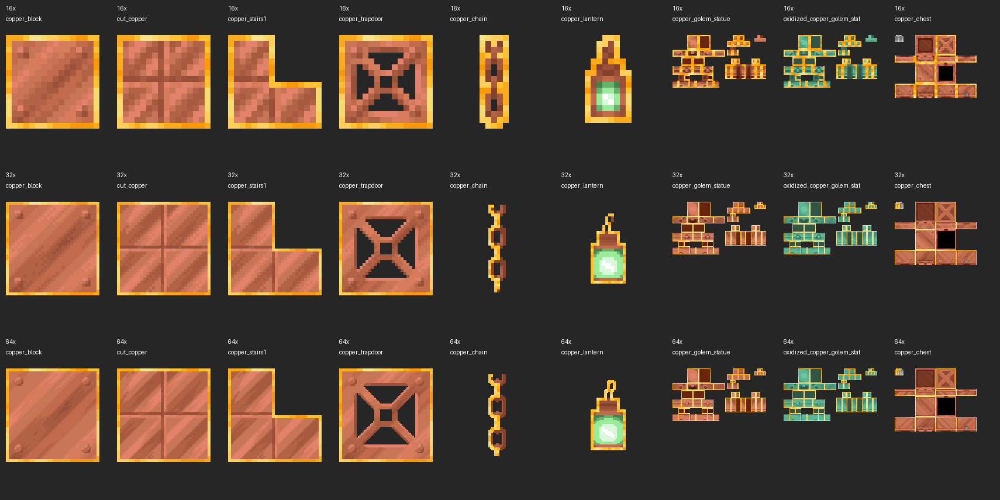

# TQNL Faithful Vanilla Tweaks

This repository contains TQNL's existing 32x tweaks compilation and the reproducible Visual Waxed Copper item add-ons.

## VisualWaxedCopperItems V3

Adds a gold wax border to copper **items**, with the corrected native copper golem statue renderer and all four poses. All four oxidation stages and the complete Vanilla Tweaks item tweak are included. Placed blocks and live golems are unchanged.

**[Download the releases](https://github.com/TQNL/TQNL-Faithful-Vanilla-Tweaks/releases).** Each target has three standalone ZIPs:

| Edition | Textures | Wax band |
| --- | --- | --- |
| 16x Statue Patch | Accepted original Vanilla Tweaks artwork and corrected statue rendering | Original artwork |
| Faithful 32x | Latest official September 2026 assets for the matching client family | 1 pixel |
| Faithful 64x | Latest official release for each client family, R11 through R15 | 2 pixels, narrower on tiny faces |

Targets: **1.21.9, 1.21.10, 1.21.11, 26.1, 26.1.1, 26.1.2, 26.2 and 26.3**, plus a **combined 1.21.9–26.3** pack in each edition. The combined packs use format overlays; 1.21.9 and 1.21.10 share format 69.0. Support stops at 26.3 / format 97.1 and is not a promise for future clients.

### Installation

1. Put **one** matching edition ZIP in `.minecraft/resourcepacks`.
2. Enable it above your other resource packs.
3. For 32x/64x, use it above the matching [official Faithful pack](https://faithfulpack.net/downloads) for a consistent world. The full Faithful pack is not bundled or required for the add-on to load.

All new edition builds have offline texture, model and overlay checks. **The new 32x/64x texture editions have not been visually tested in Minecraft.** The 16x rendering resources are byte-identical to the previously accepted exact-release fixes; their packaged metadata has been checked separately. See [verification and design](visual-copper/docs/design-and-verification.md).

The root compilation now selects the same new 32x copper resources through `overlay_69` and `overlay_copper_26`. Its other tweaks retain their pre-existing files and compatibility declarations; they were not newly tested for 26.x. Use the standalone ZIPs for the narrowly verified copper add-on.



## Sources and credit

Credits:
Vanilla Tweaks: https://vanillatweaks.net/

Faithful 32x and 64x artwork: **[Faithful Resource Pack](https://faithfulpack.net/)**. Copper texture contributors include HARYA_, eva and the authors listed per asset in [source provenance](visual-copper/source/provenance.json). TQNL adapted the wax masks and statue fixes. This is an independent add-on, not an official Faithful release.

Only the copper/lightning textures needed for this add-on are retained. Each ZIP contains its credits, source references and the original applicable Faithful license; the combined 64x ZIP contains both the V3 and V4 copies. See [Faithful's license](https://faithfulpack.net/license/) and [Vanilla Tweaks' terms](https://vanillatweaks.net/terms/).

## Build

```powershell
python -m pip install -r visual-copper/requirements.txt
python visual-copper/tools/build.py
python visual-copper/tools/native_check.py
python visual-copper/tools/integrate_compilation.py
```

The build uses the pinned minimal source files under `visual-copper/source`; ZIPs are deterministic. Native checks need a Java 25+ JDK and download hash-verified official client JARs/libraries into `visual-copper/.work`, without starting a game or creating a profile/world. The build itself needs only Python and Pillow.

The previous V2 standalone pack is retained in the separate [Faithful Add-ons repository](https://github.com/TQNL/TQNL-Faithful-Add-ons/releases/tag/VisualWaxedCopperItems).
